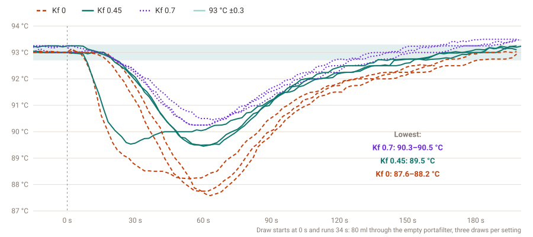
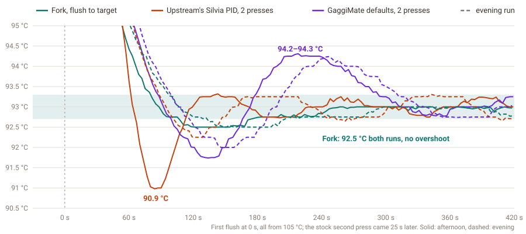
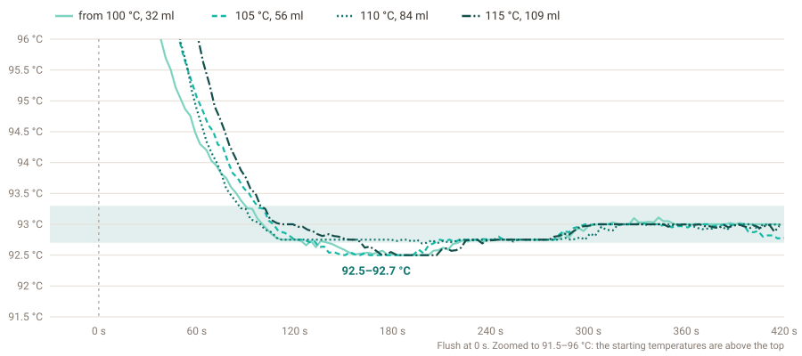

# How La Simona keeps a Silvia's boiler steady

This is the long version of the [front page](https://brisneylander.github.io/gaggimate/): what the fork changes in
GaggiMate's boiler control, why, and what I measured along the way. It's written for La Simona 7 (14 November 2026),
which also includes everything upstream GaggiMate added up to 12 November.

Everything here was measured on one machine: my Rancilio Silvia V4, 230 V with a 1100 W element, with Rancilio's boiler
insulation added and a GaggiMate Pro fitted. Every number comes from a logged run. The raw tables live in
[ROADMAP.md](../ROADMAP.md) if you want to dig further.

## The short version

GaggiMate controls the boiler heater with a **PID controller**. Several times a second it reads a temperature sensor
(a thermocouple), compares it with your target, and decides how hard to run the heater. It works a bit like cruise
control in a car: a big gap means lots of power, a small gap means a little.

The trouble is that on a Silvia the sensor is screwed to the **outside** of the boiler. It only notices a change about
20 seconds after it happens. So the controller is always reacting to old news, a bit like a shower that takes 20 seconds
to respond to the tap. That causes three things you may have noticed:

- **Overshoot after a flush.** The reading dips, the controller piles on heat, and by the time the sensor notices there's
  far too much on the way. The boiler sails past the target and takes ages to settle.
- **A big dip on the shot graph.** Some of it is real (cold water is coming in), but a lot of it is just the sensor
  lagging behind.
- **A long wait after steaming.** The boiler ends up 15-25 °C too hot, and nothing helps you get it back to brew
  temperature quickly.

Most of this fork is about working around that delay, plus a few extras built on top: flushing straight back to brew
temperature after steaming, estimating the tank water's temperature, and a safety cut-out for the heater.

What I was aiming for: hold brew temperature steadily, get back to it quickly after a flush or steaming, don't overshoot,
and make it repeatable on someone else's machine. And never trade away safety for any of it: anything that can heat the
boiler sits behind limits the control code can't get around.

## What I found

### The sensor is slow, and slow in two different ways

Heat from the element takes about **20 s** to show up on the thermocouple. Cold water from a flush shows up a bit sooner:
the dip is half way down after about **12 s**. That difference matters later, because the fork has to account for both.

### Normal GaggiMate overshoots after every flush

After a 5 second flush from 93 °C, the original control loop overshot by **+2.9 °C on average** (three runs: +2.23,
+3.75 and +2.75 °C) and took over **5 minutes** to settle back within ±0.3 °C.

Three details of the PID made it worse. You don't need to follow these to use the fork, but here they are:

- The "D" part (which reacts to how fast things are changing) was worked out from the _error_, the gap to the target.
  So every time the target changed (brew to steam, or editing the offset), it saw a sudden jump and slammed the heater
  to full power for a second.
- That same D part saw every 0.25 °C step of the thermocouple as a sudden jump, so it spent most of its time stuck at 0 %
  or 100 %.
- The "I" part (which slowly builds up to fix a steady error) kept building during and after a flush, while the sensor
  was still showing a dip the boiler had already recovered from. Then it pushed the overshoot even higher.

### Most of the overshoot is heat that's already on its way

I fitted a simple model to the logs (`scripts/fit_plant.py`) to see where the heat goes. The element warms the water with
a time constant of about 21 seconds, so heat keeps arriving well after the heater switches off. And the **group head**, a
big lump of brass, slowly swaps heat with the water over about 2.4 minutes. After a flush, the cooled group head keeps
dragging the water down for minutes.

### The flow reading depends on your pump

GaggiMate works out flow from a pump model: how much the pump delivers at 1 bar and at 9 bar. My original Ulka EX5 (48 W)
measured 8.644 and 4.676 ml/s. On 3 November I swapped it for a 35 W Olab "silent" pump, and the old numbers read about
50 % high. Weighing seven flushes on a Bluetooth scale (5, 10 and 15 s) gave 5.7 ml/s into an open group, in a neat
straight line through zero. GaggiMate's own pump calibration then confirmed 1 bar (×0.993) and corrected 9 bar (3.43
measured against 3.2 read). The Olab now reads 5.654 and 3.302.

This matters because flush to target turns millilitres into seconds of pumping using these numbers. **If you swap
pumps, recalibrate before anything else.**

### A flush takes more heat than the pump reading suggests

Weighing what goes into a jug and what goes into the drip tray separately showed the pump reading matches what reaches
the cup (89.1 g against 88.2 ml over five 10 second flushes). But **every flush also dumps about 5 g (4.8-5.7 g) into
the drip tray** when the 3-way valve releases. That water has left the boiler too. Add the group head's pull, and flush
water cools the boiler about 20 % more per ml than a simple calculation predicts.

### After steaming, the boiler is far too hot to brew

Coming back from steam, the boiler peaks at 106-110 °C, against a 93 °C brew target, and just waiting takes ages. A flush
brings it down sooner, but the amount matters. Flush too much and it undershoots: the boiler drops to about 90.8 °C, the
PID climbs back past the target, and it takes about 5 minutes to settle. Flush a calculated amount and it lands near
brew temperature and settles in under 3 minutes:

### A shot pulls the boiler down, and the heater was slow to respond

A Silvia Daily 18-36 shot (18 g in, 36 g out, 33 s) on 3 November started at 93.0 °C. The reading fell to 89.7 °C, stayed
there until the end of the shot, and took about 110 s to climb back once the pump stopped.

Some of that is just physics: the 5 second fill pulls water in faster than a 1100 W element can heat it, and the heater's
heat takes about 20 s to reach the water anyway. But through the 9 bar part of the shot, the heater was only running at
17-21 % while the reading sat 3 °C low. Three reasons: GaggiMate's thermal **feedforward** (the fourth PID value, "Kf",
which adds heater power for incoming water) was switched off; the fork pauses the "I" part while water flows; and at a Kp
of 60, a 3 °C gap only asks for about 18 % power.

With Kf set to 0.45 (roughly half the incoming water's heat), the heater ran at 78-87 % through the fill:

| Silvia Daily 18-36, 1 click finer grind, tank ~30 °C | Start   | Lowest             | End of shot         | Average     | Back at 93 °C after the pump stopped |
| ---------------------------------------------------- | ------- | ------------------ | ------------------- | ----------- | ------------------------------------ |
| Kf 0 (shot 60)                                       | 93.0 °C | 89.7 °C (−3.3)     | 89.7 °C, flat       | 90.9 °C     | ~110 s                               |
| Kf 0.45 (shot 61)                                    | 92.5 °C | 90.0 °C (−2.5)     | 90.9 °C, rising     | 91.0 °C     | not logged                           |
| **Kf 0.45 (shot 62)**                                | 93.0 °C | **90.3 °C (−2.7)** | **92.1 °C, rising** | **91.5 °C** | **~93 s, no overshoot**              |

To be fair to Kf 0: shot 62 ran about 20 % less flow than shot 60 (a tighter puck), which explains part of the
difference. Shots 61 and 62 together still show the same pattern. What's left after the shot is about 0.75 °C, which
comes back over a minute. In the simulator, a higher Kp, a higher Ki or a burst of full power once the water stopped each
saved less than 10 seconds of that and caused overshoot, because the heat is still on its way when the reading catches
up. So I left them out.

**Taking the coffee out of it.** Every puck is a bit different, so on the evening of 3 November I wrote a bench profile
(`scripts/bench/synthetic_shot.mjs`) that draws exactly the same water every time: a 5 s fill at full flow, then 1.8 ml/s
for 28 s, 80 ml in 34 s, through an empty portafilter, starting from a reading settled at 93 °C. Three draws for each Kf
setting:

| Kf   | Lowest reading        | Average dip | Back within ±0.3 °C after the draw | Highest after |
| ---- | --------------------- | ----------- | ---------------------------------- | ------------- |
| 0    | 88.2 / 87.6 / 87.8 °C | −5.2 °C     | 132-146 s                          | 93.0-93.2 °C  |
| 0.45 | 89.5 / 89.5 / 89.5 °C | **−3.6 °C** | 103-119 s                          | 93.3 °C       |
| 0.7  | 90.3 / 90.5 / 90.3 °C | **−2.9 °C** | 83-101 s                           | 93.5 °C       |

Each setting's three draws agree within 0.6 °C, so this is a fair comparison. The lowest reading comes 20-30 s after the
draw ends, which is the sensor's lag again. Kf 0.7 takes another 0.7 °C off the dip for 0.2 °C more overshoot, and it's
what my machine runs now. (The third Kf 0 draw lost its connection before its recovery was logged.)

### The dip on a shot graph is mostly the sensor

Over 30 real shots between 6 and 13 November (Kf 0.7), the reading bottomed out at 88-90 °C. That looks bad, but watch
what happens when the pump stops: the reading climbs back 3-4 °C in under a minute while the heater is at 0-12 %. That
heat was already in the boiler; the sensor just hadn't caught up.

During the shot itself the heater averaged 76 % and was only at full power a quarter of the time, because the fork knows
heat is already on its way and holds back. Someone on the GaggiMate Discord measured inside the basket and saw it stay
within about 1.2 °C of target while the graph dipped 5 °C. So, as far as the graph goes: don't panic.

On 13 November I ran another bench, this time with a draw shaped like a real Silvia Daily shot (8 s at full flow, then
1.8 ml/s for 18 s, about 80 ml, empty portafilter), comparing Kf 0.7 with 1.0:

| Draw                   | Kf  | Dip     | Lowest  | Heater during the draw |
| ---------------------- | --- | ------- | ------- | ---------------------- |
| 12 min after switch-on | 0.7 | −6.5 °C | 86.5 °C | 89 %                   |
| 18 min after switch-on | 1.0 | −5.1 °C | 87.8 °C | 91 %                   |
| warm                   | 0.7 | −3.2 °C | 89.9 °C | 56 %                   |
| warm                   | 1.0 | −2.6 °C | 90.5 °C | 63 %                   |
| warm                   | 0.7 | −3.3 °C | 89.7 °C | 57 %                   |
| warm                   | 1.0 | −3.2 °C | 89.9 °C | 67 %                   |

Kf 1.0 made no reliable difference: about 0.3 °C, which is less than the spread between runs, and it overshot a little
more afterwards. So 0.7 stays.

The more useful finding is in the first two rows. **Even after the reading had held 93 °C for 90 seconds, a shot 12-18
minutes after switch-on dipped about twice as far, with the heater flat out.** The group head was still soaking up heat.
About 30 minutes after switch-on, it's fine. This one applies to any Silvia, fork or not.

### How it compares with normal settings

On 30 October I put four setups through the same routine: hold at 93 °C for 5 minutes, steam to 100 °C, switch back to
brew, then do what an owner would at the peak. On normal settings that's pressing flush twice; on the fork it's pressing
it once, which flushes to target. The "normal" setups ran the fork's firmware with all its extras switched off.

| Setup (2 runs each)                                                                           | Holding at 93 °C: 90 % band (peak to peak) | Peak after steam   | Lowest after flush  | Overshoot after  | Settled ±0.3 °C after the flush |
| --------------------------------------------------------------------------------------------- | ------------------------------------------ | ------------------ | ------------------- | ---------------- | ------------------------------- |
| **Fork profile, one press (flush to target)**                                                 | **0.33–0.35 °C (0.43–0.45)**               | **105.7–106.7 °C** | 92.25–92.5 °C       | **0 to +0.2 °C** | 203–272 s                       |
| Autotuned PID 60 / 0.658 / 1500, extras off, two flushes                                      | 0.41–0.72 °C (0.47–0.75)                   | 110.5–111.5 °C     | 92.75–93.06 °C      | 0 to +0.25 °C    | 265–348 s                       |
| GaggiMate's suggested Silvia PID 112.315 / 0.658 / 1436.887, extras off, two flushes          | 0.41–0.67 °C (0.71–0.74)                   | 111.5–112.2 °C     | 92.25 °C            | +0.75 to +0.8 °C | 236–375 s                       |
| GaggiMate's default PID 58.397 / 1.027 / 249.055 (the Gaggia values), extras off, two flushes | 1.5 °C (1.54–1.69)                         | 112.0–112.5 °C     | 91.9–92.2 °C        | +1.6 to +1.75 °C | not within 7½ min               |
| GaggiMate's suggested Silvia PID, one press of the 5 s flush                                  | 0.74 °C                                    | 112.8 °C           | 96.9 °C after 4 min |                  | not settled                     |

Each setup flushed at its own peak, and the normal setups peaked 5-6 °C higher, so the flush columns compare the whole
routine rather than the flush alone. That's why I re-ran it with every setup flushing from the same temperature (below).

Why does holding steady matter? Your shot starts at whatever the boiler happens to read when you press brew, so a
steadier hold means more consistent shots. One caveat: the sensor is on the boiler wall and the water itself swings
less, so treat these numbers as a comparison between setups, not as your actual shot temperature.

**Same starting point (3 November).** Same routine, but every setup waited until the reading had cooled to 105 °C before
flushing. Two runs each, afternoon and evening, tank 27-30 °C, no portafilter, Olab pump (so a 5 s press is about
29 ml). With this pump, the normal two presses and the fork's single flush to target pushed about the same amount of
water, so the difference is purely what the heater does afterwards:

| Setup, flushing from 105 °C (2 runs)                      | Steam peak     | Water    | Lowest            | Peak after         | Settled ±0.3 °C         |
| --------------------------------------------------------- | -------------- | -------- | ----------------- | ------------------ | ----------------------- |
| **Fork, one press (flush to target)**                     | 111.2-111.3 °C | 56-59 ml | **92.5, 92.5 °C** | **93.0, 93.05 °C** | **176, 205 s**          |
| GaggiMate's suggested Silvia PID, extras off, two presses | 113.0-116.6 °C | 60 ml    | 90.9, 92.25 °C    | 93.3, 93.3 °C      | 200 s; not within 7 min |
| GaggiMate's default PID, extras off, two presses          | 111.3-112.0 °C | 57-60 ml | 91.7, 92.0 °C     | 94.3, 94.2 °C      | 291 s; not within 7 min |

### Flush to target from different temperatures

How well does flush to target cope with different starting temperatures? Here it is from 100, 105, 110 and 115 °C on La
Simona 3 (evening of 3 November) and La Simona 4 (4 November), one run each except the two at 105 °C. La Simona 4 fixed
a detail: during the heater pause after a flush, the "I" part of the PID now keeps its value instead of being wiped.

| Flushed from           | Water (LS3, LS4) | Lowest (LS3, LS4)  | Peak after (LS3, LS4) | Settled ±0.3 °C (LS3, LS4) |
| ---------------------- | ---------------- | ------------------ | --------------------- | -------------------------- |
| 100 °C                 | 32, 32 ml        | 92.5, **92.75 °C** | 93.1, 93.0 °C         | 240, **118 s**             |
| 105 °C                 | 56-59, 54 ml     | 92.5, **92.95 °C** | 93.0, 93.25 °C        | 176-205, **76 s**          |
| 110 °C                 | 84, 84 ml        | 92.7, **92.75 °C** | 93.0, 93.0 °C         | 228, **114 s**             |
| 115 °C (LS4: 114.3 °C) | 109, 103 ml      | 92.5, **92.75 °C** | 93.0, 93.0 °C         | 236, **125 s**             |

It sizes the flush from 32 ml at 100 °C up to 109 ml at 115 °C. On La Simona 4 the reading stays within 0.25 °C of 93
once it has come down, so the "settled" time is mostly just the boiler cooling to 93; the slow crawl back from half a
degree under is gone. The logged heater power doesn't differ clearly between the two releases, so the kept "I" value is
the likely cause rather than a proven one. (Kf was 0.7 on La Simona 4 and 0.45 on 3, but feedforward only acts while
water flows, and the heater is held off during the flush anyway.)

**Re-checked on La Simona 7** (14 November, after the upstream merge, same routine):

| Flushed from | Water  | Lowest   | Peak after | Settled ±0.3 °C |
| ------------ | ------ | -------- | ---------- | --------------- |
| 100 °C       | 29 ml  | 92.76 °C | 93.0 °C    | 82 s            |
| 105 °C       | 55 ml  | 91.29 °C | 93.75 °C   | 282 s           |
| 110 °C       | 80 ml  | 92.76 °C | 93.24 °C   | 72 s            |
| 114.4 °C     | 103 ml | 92.86 °C | 92.99 °C   | 88 s            |

The three runs on a warm machine match La Simona 4's lows and settle faster. The 105 °C run was first, only about 13
minutes after switching on from cold. The flush was sized the same (55 against 54 ml), but the cold group head kept
pulling heat and the boiler kept cooling past 93 °C, exactly the warm-up effect described above. I didn't repeat it on a
warm machine.

Two more things from these runs. The fork no longer peaks lower after steaming than normal settings do (it did, at
105.7-106.7 °C, on 30 October): since then the heat-up boost runs flat out while steaming, so it heats as fast as the
others and carries as much heat back into brew mode. And the evening runs confirmed a La Simona 3 fix: switching from
normal settings back to the fork's settled at 93.0-93.2 °C within a minute, where on La Simona 2 the heater had run flat
out for 20 s and pushed the boiler to 101.9 °C.

### The tank warms up

The water tank sits right next to the boiler. It starts at about 25 °C when freshly filled and reaches about 40 °C after
a few hours on (and anywhere from 15 to 45 °C across a year). Every flush calculation depends on how warm that water is.

### Some failure cases the normal checks don't cover

- A thermocouple that comes loose from the boiler reads room temperature, so the PID heats flat out. Only the machine's
  own thermal fuse would stop it.
- One autotune run coasted to **131 °C** after reaching its 125 °C limit.
- Once, a brew stopped within a second left the controller reporting 5 ml/s of flow for over a minute with no water
  moving. The fork counted cold water that wasn't there and heated the boiler from 93 to 98 °C.

## What the fork changes

Here's how each problem above is handled in the code. The "Where" column is for anyone who wants to read the source.

| Problem                                                | Change                                                                                                                                                                                                                                                                                                            | Where                                                             | Result on the bench                                                                                                                                                                                   |
| ------------------------------------------------------ | ----------------------------------------------------------------------------------------------------------------------------------------------------------------------------------------------------------------------------------------------------------------------------------------------------------------- | ----------------------------------------------------------------- | ----------------------------------------------------------------------------------------------------------------------------------------------------------------------------------------------------- |
| D part kicking on target changes                       | D worked out from the measurement, not the error                                                                                                                                                                                                                                                                  | `lib/NayrodPID/src/SimplePID`                                     | No more full-power kicks switching brew ↔ steam                                                                                                                                                      |
| D part chattering on sensor steps                      | Optional smoothing filter on the D part (2 s)                                                                                                                                                                                                                                                                     | `SimplePID`, setting _Derivative filter_                          | Idle heater chatter cut about 3× (simulator)                                                                                                                                                          |
| I part building up during flushes                      | I only builds within ±1.5 °C of target, and pauses while water flows and for the delay after                                                                                                                                                                                                                      | `SimplePID`, `Heater`, setting _Integral zone_                    | Part of the combined result below                                                                                                                                                                     |
| Acting on a reading ~20 s old                          | **Heat-balance predictor** (in the style of a Smith predictor): counts heater energy and flush water that haven't reached the sensor yet, and adds them to the reading the PID sees                                                                                                                               | `lib/GaggiMateController/src/peripherals/HeatBalancePredictor.*`  | With one shared 20 s delay: +1.68 °C overshoot, 174 s to settle                                                                                                                                       |
| Flush water and heater heat arrive at different speeds | A separate **water delay** (12 s on the Silvia)                                                                                                                                                                                                                                                                   | predictor, setting _Water dead time_                              | **+0.63 °C overshoot, 126 s to settle** (was +2.9 °C, 318 s)                                                                                                                                          |
| Heat loss differs between brew and steam               | Loss learned in watts per °C above room temperature, saved and restored across restarts                                                                                                                                                                                                                           | predictor, display saves `modelLossW`                             | No sag at start-up, and holds at steam temperature too                                                                                                                                                |
| Valve dump not counted                                 | About 5 ml counted as boiler water every time the flow stops                                                                                                                                                                                                                                                      | predictor, flush to target, setting _Valve dump per flush_        | Flush to target lands without undershoot (run 7)                                                                                                                                                      |
| Boiler far too hot after steaming                      | **Flush to target**: works out how much tank water brings the boiler down to brew temperature (the surplus heat, divided by what each ml takes away at the boiler-minus-tank temperature, less the loss during the flush and a heater pause), flushes exactly that, then holds the heater off for 30 s            | `src/display/core/FlushToTarget.h`, `Controller::flushToTarget()` | From ~106 °C: lowest 91.8–92.2 °C, settled within ±0.3 °C 161–174 s after the flush (bigger flushes: 90.8 °C and 287–317 s); with the dump counted, run 7 settled at 87.7–88.0 °C for an 88 °C target |
| Flush to target needs a correction for the group head  | An adjustable _Flush to target factor_ (0.91 on the Silvia)                                                                                                                                                                                                                                                       | setting, tuned by the routine below                               |                                                                                                                                                                                                       |
| Using it day to day                                    | The flush button flushes to target whenever the boiler is 2 °C or more over target (setting _Flush to brew target when hot_)                                                                                                                                                                                      | `Controller::onFlush()`                                           |                                                                                                                                                                                                       |
| Tank temperature drifting                              | **Tank estimate**: warms from a seasonal fill temperature while on, cools in standby, resets on a refill (button, or the Alba water level back to full), and a check after each plain flush catches a refill it missed                                                                                            | `TankTemperature.h`, `FlushTankCheck.h`                           | Tank temperature worked out from flushes: 31.0, 39.5 and 32.5 °C against 32 °C measured                                                                                                               |
| Loose thermocouple                                     | **Heater safety layer**: the one place the heater is switched asks it first. It latches the heater off for near full power with no water flowing and no 2 °C rise in 60 s (300 s at steam temperatures), implausible jumps, 10 minutes at full power, over 170 °C, or a failing sensor, each with its own message | `HeaterSafety.h`, `Heater::writeOutput()`                         | Replayed over all 52 bench logs: never trips                                                                                                                                                          |
| Autotune coasting past its limit                       | Stops when the reading plus its rate of rise × the measured delay would pass 125 °C, and ends like a timeout (gains kept)                                                                                                                                                                                         | `Autotune::predictedCoast()`, `Heater::loopAutotune()`            |                                                                                                                                                                                                       |
| Boiler sagging through a shot                          | GaggiMate's thermal feedforward (Kf) switched on alongside the predictor: heater power for the incoming water. It switches off more than 1 °C over target, so it doesn't fight flush to target                                                                                                                    | `Heater::loopPid()`, the fourth PID value                         | Daily 18-36 shot at Kf 0.45: lowest −2.7 instead of −3.3 °C, ended 0.9 instead of 3.3 °C low, back at 93 °C ~90 s after the pump stopped, no overshoot. Now runs at 0.7                               |
| Stuck flow reading                                     | The display re-sends "pump off" if flow is reported with nothing running for 3 s                                                                                                                                                                                                                                  | `StrayFlowGuard.h`                                                | Didn't happen again in four tries; the guard covers it                                                                                                                                                |

### Setting it up on your machine

All of the above is off or neutral until you configure it, so a machine that isn't set up behaves just like normal
GaggiMate.

- **Machine Boiler Profile** (Settings → Machine) holds all the machine-specific values. The **machine profile** picker
  fills them in for you: Rancilio Silvia 230 V has everything measured here, and there are starting points for the
  Gaggia Classic family and two DeLonghis. You can also import a profile from JSON, or export yours.
- **Tune this machine** (Settings → Calibration) measures the values for a machine that isn't a Silvia: an autotune
  from cold gives the heat-up rate and delay; a logged and weighed 5 second flush gives the water delay, the valve dump
  and a pump check; and a flush to target after steaming sets the correction factor.
- **After a pump swap**, run the pump calibration (Settings → Calibration, with a Bluetooth scale) before trusting flush
  to target. It's what turns millilitres into seconds of pumping.

## Tried and dropped

Every idea went on the bench. These didn't earn their place:

| Idea                                                           | What happened                                                 | Why it went                                                                                                                                                                                    |
| -------------------------------------------------------------- | ------------------------------------------------------------- | ---------------------------------------------------------------------------------------------------------------------------------------------------------------------------------------------- |
| Full power to reheat after a flush                             | Slower back to target (124–129 s against 62–100 s)            | Heat takes about 2 minutes to reach the sensor, so delivering it faster just overshoots the wait                                                                                               |
| Boost, then flush the extra off (heat 5 °C over first)         | 366–375 s to settle against 74–84 s                           | Heating up takes as long as a plain recovery, then the flush starts another one                                                                                                                |
| A detailed thermal model steering the water estimate           | No difference at the sensor (+0.69 vs +0.66 °C, 120 vs 116 s) | Any gain would be in the water itself, which needs a probe inside the boiler to see                                                                                                            |
| Switching the heater on mains half-cycles                      | Not built                                                     | About 0.02 °C of ripple at holding power, which the sensor can't even see                                                                                                                      |
| Holding a shot exactly at the target                           | Simulated and measured                                        | A shot's fill pulls about 2 kW, twice what the 1100 W element can give, so some sag is just the boiler's limit. Feedforward recovers part of it; set your profile a little hotter for the rest |
| Higher Kp or Ki, or a top-up, for the last degree after a shot | Simulated (3 November)                                        | Each saved under 10 s of a ~90 s recovery and added 0.25-0.5 °C of overshoot after flushes and shots                                                                                           |
| Feedforward above 0.7                                          | Synthetic shots, 1.0 against 0.7 (13 November)                | About 0.3 °C less dip, inside the run-to-run spread, and a little more overshoot afterwards                                                                                                    |

## The simulator

`test/test_heat_balance_predictor` holds a three-part model of the boiler (element, water and group head, plus the
sensor's delay and lag), fitted to my Silvia's logs. On flushes it wasn't fitted to, it tracks the sensor to within
0.45 °C rms (the original model managed 1.09 °C). The tests check every controller change against it, including the
bench setups, a replayed shot, and the model being off by ±25 %. But the bench always has the final say on timing.

## La Simona 7 and upstream

La Simona 7 brings in upstream GaggiMate's master branch up to 12 November 2026 (44 commits): the setup wizard, machine
hardware settings, a separate steam-boiler PID for dual-boiler machines, the hardware-scale tare split, profile list
fixes and Smart Dose, among others. The boiler control described here is unchanged.

One technical note: upstream had started using some of the message numbers the fork used between the display and the
controller, so the fork's heater settings moved to new numbers (30-42) and its valve report to 30. Both boards always
update together, so nothing is lost. Flush to target also keeps upstream's new check that the controller has confirmed
its hardware settings before a flush starts.

## Still to do

See [ROADMAP.md](../ROADMAP.md): calibrating the tank estimate, the Silvia's steam switch wiring, fitting the fork's
machine profiles into upstream's new setup wizard, and fixing shots that skip their fill phase when pressure is still
trapped in the boiler from the shot before.

---

_Last updated 14 November 2026._
