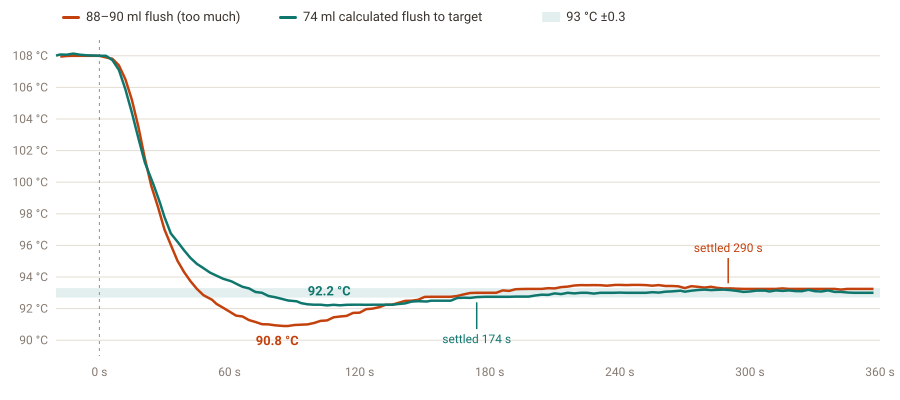
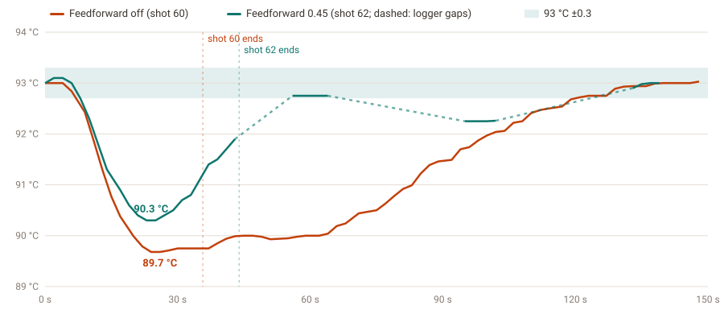

# Boiler temperature control on this fork

What this fork changes in GaggiMate's boiler control, why, and what the bench showed. Measured on a Rancilio Silvia
230 V (1100 W) with a GaggiMate Pro, 2026-10-28/29. Every number below comes from a logged run; the raw tables are in
[ROADMAP.md](../ROADMAP.md).

## Goal

Hold the brew temperature steadily and get back to it quickly after a flush or steaming, without the overshoot the
stock loop produces, and make the result easy to reproduce on another machine. Safety is not traded for any of it:
anything that can heat the boiler sits behind limits the control code can't bypass.

## What we observed

### The sensor is slow, and slow in two different ways

The Silvia's thermocouple sits on the outside of the boiler. Heater heat takes about **20 s** to show on it; cold flush
water shows sooner, with the dip half way down after about **12 s**. A plain PID acting on that reading is always
answering a question from 20 s ago.

### The stock loop overshoots after every flush

After a 5 s flush from 93 °C the original loop overshot by **+2.9 °C on average** (three runs: +2.23, +3.75,
+2.75 °C) and took over **5 minutes** to settle within ±0.3 °C. Three things in the PID made it worse:

- The derivative was taken on the _error_, so every setpoint change (brew ↔ steam, an offset edit) and the first
  sample after a reset kicked the output to full power for a second.
- The derivative term saw the thermocouple's 0.25 °C steps as large jumps, so it spent most of its time clipped at 0 %
  or 100 %.
- During and after a flush the integral wound up on a dip the sensor was still showing after the boiler had
  recovered, then pushed the overshoot.

### Most of the overshoot is heat already on its way

Fitting a model to the logs (`scripts/fit_plant.py`) showed where the heat goes: the element warms the water with a
~21 s time constant, so heat keeps arriving after the heater turns off, and the **group head** (a large brass mass)
slowly trades heat with the water over about 2.4 minutes. After a flush the cooled group head keeps pulling the water
down for minutes.

### The pump reading depends on the pump

The flow reading comes from a pump model (flow at 1 and 9 bar). The Silvia's Ulka EX5 (48 W) measured 8.644 and 4.676
ml/s. After a swap to a 35 W Olab "silent" pump on 2026-11-03, the same model read about 50 % high: seven flushes
weighed on a Bluetooth scale (5, 10 and 15 s) gave 5.7 ml/s into an open group, in a straight line through zero, and
GaggiMate's pump calibration then confirmed 1 bar (×0.993) and corrected 9 bar (3.43 measured against 3.2 read). The
Olab now reads 5.654, 3.302. Flush to target turns millilitres into pump seconds with this figure, so a pump swap
needs a recalibration before anything else.

### A flush takes more heat than the pump reading suggests

Weighing flushes in a jug and the drip tray separately showed the pump reading matches what reaches the cup (89.1 g
against 88.2 ml over five 10 s flushes), but **every flush also dumps 5 g (4.8–5.7 g) into the drip tray** when the
3-way valve releases. That water has left the boiler too. Together with the group head, flush water cools the boiler
about 20 % more per ml than a simple calculation predicts.

### After steaming, the boiler is far too hot to brew

Coming back from steam, the boiler peaks at 106–110 °C against a 93 °C brew target, and a plain wait takes many
minutes to come down. A flush brings it down sooner, but the amount matters. Too much water undershoots: the
boiler drops to about 90.8 °C, the PID then climbs back past the target, and it takes about 5 minutes to settle. A
calculated amount lands near the brew temperature and settles in under 3 minutes:

### A shot pulls the boiler down, and the heater answered late

A Silvia Daily 18-36 shot (18 g in, 36 g out, 33 s) on 2026-11-03 started at 93.0 °C and the reading fell to 89.7 °C,
then sat there to the end of the shot and took about 110 s to climb back after the pump stopped. Some of that is the
boiler's limit: the 5 s fill draws water faster than the 1100 W element can heat it, and heater heat takes ~20 s to
reach the water. But through the 9 bar phase the heater ran at only 17-21 % while the reading sat 3 °C under:
upstream's thermal feedforward (the fourth PID value, Kf) was off, the integral is held while water flows, and at
Kp 60 a 3 °C shortfall asks for only ~18 %. With Kf at 0.45 (about half the water's heat) the heater ran at 78-87 %
through the fill:

| Silvia Daily 18-36, 1 click finer grind, tank ~30 °C | Start   | Lowest             | End of shot         | Mean        | Back at 93 °C after the pump stopped |
| ---------------------------------------------------- | ------- | ------------------ | ------------------- | ----------- | ------------------------------------ |
| Kf 0 (shot 60)                                       | 93.0 °C | 89.7 °C (−3.3)     | 89.7 °C, flat       | 90.9 °C     | ~110 s                               |
| Kf 0.45 (shot 61)                                    | 92.5 °C | 90.0 °C (−2.5)     | 90.9 °C, rising     | 91.0 °C     | not logged                           |
| **Kf 0.45 (shot 62)**                                | 93.0 °C | **90.3 °C (−2.7)** | **92.1 °C, rising** | **91.5 °C** | **~93 s, no overshoot**              |

Shot 62 ran about 20 % less flow than shot 60 (a tighter puck), which accounts for part of the difference; shots 61 and
62 together show the same pattern. What's left after the shot is about 0.75 °C that comes back over a minute at
holding power. In the simulator a higher Kp, a higher Ki or a full-power top-up once the water stops each saved under
10 s of that and added overshoot (heat still on its way when the reading catches up), so they were left out.

**Synthetic shots (2026-11-03 evening).** To take the puck out of it, a bench profile drew the same water every time
(a 5 s fill at full flow, then 1.8 ml/s for 28 s: 80 ml in 34 s) through the empty portafilter, from a reading settled
at 93 °C, alternating Kf (`scripts/bench/synthetic_shot.mjs`, three draws each):

| Kf   | Lowest reading        | Mean drop   | Back within ±0.3 °C after the draw | Highest after |
| ---- | --------------------- | ----------- | ---------------------------------- | ------------- |
| 0    | 88.2 / 87.6 / 87.8 °C | −5.2 °C     | 132-146 s                          | 93.0-93.2 °C  |
| 0.45 | 89.5 / 89.5 / 89.5 °C | **−3.6 °C** | 103-119 s                          | 93.3 °C       |
| 0.7  | 90.3 / 90.5 / 90.3 °C | **−2.9 °C** | 83-101 s                           | 93.5 °C       |

Each setting's three draws agree within 0.6 °C. The lowest reading comes 20-30 s after the draw ends (the sensor's
lag). 0.7 takes another 0.7 °C off the dip for +0.2 °C more overshoot; the Silvia profile keeps 0.45 until 0.7 has
been tried on real shots. (The third Kf 0 draw lost its connection before its recovery was logged.)

### Against stock settings: holding and after steam

On 2026-10-30 the same machine ran four setups through the same routine: a 5 minute idle hold at 93 °C, then steam
to 100 °C, back to Brew, and what an owner does at the peak (stock settings: press flush twice; the fork: press once,
which flushes to target). Stock setups ran with every compensation setting at 0.

| Setup (2 runs each)                                                                                 | Holding at 93 °C: 90 % band (peak to peak) | Peak after steam   | Lowest after flush  | Overshoot after  | Settled ±0.3 °C after the flush |
| --------------------------------------------------------------------------------------------------- | ------------------------------------------ | ------------------ | ------------------- | ---------------- | ------------------------------- |
| **Fork profile, one press (flush to target)**                                                       | **0.33–0.35 °C (0.43–0.45)**               | **105.7–106.7 °C** | 92.25–92.5 °C       | **0 to +0.2 °C** | 203–272 s                       |
| Autotuned PID 60 / 0.658 / 1500, compensation off, two flushes                                      | 0.41–0.72 °C (0.47–0.75)                   | 110.5–111.5 °C     | 92.75–93.06 °C      | 0 to +0.25 °C    | 265–348 s                       |
| Upstream's Silvia PID 112.315 / 0.658 / 1436.887, compensation off, two flushes                     | 0.41–0.67 °C (0.71–0.74)                   | 111.5–112.2 °C     | 92.25 °C            | +0.75 to +0.8 °C | 236–375 s                       |
| GaggiMate's default PID 58.397 / 1.027 / 249.055 (the Gaggia values), compensation off, two flushes | 1.5 °C (1.54–1.69)                         | 112.0–112.5 °C     | 91.9–92.2 °C        | +1.6 to +1.75 °C | not within 7½ min               |
| Upstream's Silvia PID, one press of the 5 s flush                                                   | 0.74 °C                                    | 112.8 °C           | 96.9 °C after 4 min |                  | not settled                     |

Each setup flushed at its own peak, and the stock setups peaked 5-6 °C higher, so the flush column compares the whole
routine rather than the flush alone. A matched re-run, every setup flushing from the same 105 °C, follows the table.

Holding steadiness is what makes shots repeatable: a shot starts at whatever the boiler reads when brew is pressed.
The sensor is on the boiler wall and the water swings less, so these are a fair comparison between setups rather than
the spread of the shots themselves.

**Matched after steam (2026-11-03).** The same routine with one change: every setup waited until the reading had
fallen to 105 °C before the flush (two runs each, afternoon and evening, tank 27-30 °C, no portafilter, Olab pump, so a
5 s press is ~29 ml). On this pump the stock routine's two presses and the fork's flush to target pumped about the
same water, so the difference is the heater afterwards:

| Setup, flushing from 105 °C (2 runs)                   | Steam peak     | Water    | Lowest            | Peak after         | Settled ±0.3 °C         |
| ------------------------------------------------------ | -------------- | -------- | ----------------- | ------------------ | ----------------------- |
| **Fork, one press (flush to target)**                  | 111.2-111.3 °C | 56-59 ml | **92.5, 92.5 °C** | **93.0, 93.05 °C** | **176, 205 s**          |
| Upstream's Silvia PID, compensation off, two presses   | 113.0-116.6 °C | 60 ml    | 90.9, 92.25 °C    | 93.3, 93.3 °C      | 200 s; not within 7 min |
| GaggiMate's default PID, compensation off, two presses | 111.3-112.0 °C | 57-60 ml | 91.7, 92.0 °C     | 94.3, 94.2 °C      | 291 s; not within 7 min |

And flush to target from other temperatures (evening, one run each):

| Flushed from | Water    | Lowest  | Peak after | Settled ±0.3 °C |
| ------------ | -------- | ------- | ---------- | --------------- |
| 100 °C       | 32 ml    | 92.5 °C | 93.1 °C    | 240 s           |
| 105 °C       | 56-59 ml | 92.5 °C | 93.0 °C    | 176-205 s       |
| 110 °C       | 84 ml    | 92.7 °C | 93.0 °C    | 228 s           |
| 115 °C       | 109 ml   | 92.5 °C | 93.0 °C    | 236 s           |

From 100 to 115 °C it sizes the flush from 32 to 109 ml and lands at 92.5-92.7 °C every time, without overshoot.

The fork no longer peaks lower after steaming (105.7-106.7 °C on 2026-10-30): since then the heat-up boost runs the
heater flat out while steaming, so it climbs as fast as the stock setups and carries as much heat past the switch back
to Brew. The evening runs also showed La Simona 3's fix: switching from the stock settings back to the fork's settled
at 93.0-93.2 °C within a minute, where in the afternoon (La Simona 2) the heater ran flat out for 20 s and the boiler
reached 101.9 °C.

### The tank warms up

The tank sits beside the boiler: about 25 °C fresh, about 40 °C after a few hours on (and 15–45 °C across a year).
Every flush calculation depends on it.

### Some failure cases the stock checks don't cover

- A thermocouple that comes loose from the boiler reads room temperature, so the PID heats flat out; only the
  machine's own thermal fuse would stop it.
- One autotune run coasted to **131 °C** after reaching its 125 °C limit.
- Once, a brew stopped within a second left the controller reporting 5 ml/s of flow for over a minute with no water
  moving; the compensation counted cold water that wasn't there and heated the boiler from 93 to 98 °C.

## How the code addresses it

| Problem                                                | Change                                                                                                                                                                                                                                                                                                             | Where                                                             | Result on the bench                                                                                                                                                                                   |
| ------------------------------------------------------ | ------------------------------------------------------------------------------------------------------------------------------------------------------------------------------------------------------------------------------------------------------------------------------------------------------------------ | ----------------------------------------------------------------- | ----------------------------------------------------------------------------------------------------------------------------------------------------------------------------------------------------- |
| Derivative kick on setpoint changes                    | Derivative on the measurement, not the error                                                                                                                                                                                                                                                                       | `lib/NayrodPID/src/SimplePID`                                     | No more full-power kicks on brew ↔ steam                                                                                                                                                             |
| D term chattering on sensor steps                      | Optional low-pass filter on the D term (2 s)                                                                                                                                                                                                                                                                       | `SimplePID`, setting _Derivative filter_                          | Idle heater chatter cut about 3× (simulator)                                                                                                                                                          |
| Integral winding up during flushes                     | Integral only within ±1.5 °C, paused while water flows and for the dead time after                                                                                                                                                                                                                                 | `SimplePID`, `Heater`, setting _Integral zone_                    | Part of the combined result below                                                                                                                                                                     |
| Acting on a reading ~20 s old                          | **Heat-balance predictor** (Smith-predictor style): counts heater energy and flush water still on their way to the sensor and adds that to the reading the PID sees                                                                                                                                                | `lib/GaggiMateController/src/peripherals/HeatBalancePredictor.*`  | With one shared 20 s delay: +1.68 °C overshoot, 174 s to settle                                                                                                                                       |
| Flush water and heater heat arrive at different speeds | Separate **water dead time** (12 s on the Silvia)                                                                                                                                                                                                                                                                  | predictor, setting _Water dead time_                              | **+0.63 °C overshoot, 126 s to settle** (from +2.9 °C, 318 s)                                                                                                                                         |
| Standing loss differs between brew and steam           | Loss learned in watts per °C above the room, saved and restored across restarts                                                                                                                                                                                                                                    | predictor, display saves `modelLossW`                             | No sag on start, holds at steam temperature too                                                                                                                                                       |
| Valve dump not counted                                 | ~5 ml counted as boiler water each time the flow stops                                                                                                                                                                                                                                                             | predictor, flush to target, setting _Valve dump per flush_        | Flush to target lands without undershoot (run 7)                                                                                                                                                      |
| Boiler far too hot after steaming                      | **Flush to target**: works out the tank water needed to bring the boiler down to the brew temperature (surplus × heat capacity, per ml at the boiler-minus-tank temperature, less the standing loss during the flush and a heater hold), then flushes exactly that; heater held off for 30 s after                 | `src/display/core/FlushToTarget.h`, `Controller::flushToTarget()` | From ~106 °C: lowest 91.8–92.2 °C, settled within ±0.3 °C 161–174 s after the flush (bigger flushes: 90.8 °C and 287–317 s); with the dump counted, run 7 settled at 87.7–88.0 °C for an 88 °C target |
| Flush to target needs a correction for the group head  | Empirical _Flush to target factor_ (0.91 on the Silvia)                                                                                                                                                                                                                                                            | setting, tuned by the routine below                               |                                                                                                                                                                                                       |
| Using it day to day                                    | The flush button flushes to target when the boiler is 2 °C or more over target (toggle _Flush to brew target when hot_)                                                                                                                                                                                            | `Controller::onFlush()`                                           |                                                                                                                                                                                                       |
| Tank temperature drifting                              | **Tank estimate**: warms from a seasonal fill temperature while on, cools in standby, resets on a refill (button, or the Alba water level back to full), and a check after each plain flush catches a refill it missed                                                                                             | `TankTemperature.h`, `FlushTankCheck.h`                           | Flush-implied tank 31.0, 39.5, 32.5 °C against 32 °C measured                                                                                                                                         |
| Loose thermocouple                                     | **Heater safety layer**: the one place the heater pin is driven asks it first; it latches the heater off for near full power with no water flowing and no 2 °C rise in 60 s (300 s at steam temperatures), implausible jumps, 10 minutes at full power, over 170 °C or a failing sensor, each with its own message | `HeaterSafety.h`, `Heater::writeOutput()`                         | Replayed over all 52 bench logs: never trips                                                                                                                                                          |
| Autotune coasting past its limit                       | Stops when the reading plus rate × measured delay would pass 125 °C, and ends like a timeout (gains kept)                                                                                                                                                                                                          | `Autotune::predictedCoast()`, `Heater::loopAutotune()`            |                                                                                                                                                                                                       |
| Boiler sagging through a shot                          | Upstream's thermal feedforward (Kf) turned on alongside the predictor: heater power for the water flowing in, at 0.45 of its heat; off more than 1 °C over the setpoint, so it doesn't fight flush to target                                                                                                       | `Heater::loopPid()`, the fourth PID value                         | Daily 18-36 shot: lowest −2.7 instead of −3.3 °C, ended 0.9 instead of 3.3 °C under, back at 93 °C ~90 s after the pump stopped, no overshoot                                                         |
| Stuck flow reading                                     | Display re-sends "pump off" when flow is reported with nothing running for 3 s                                                                                                                                                                                                                                     | `StrayFlowGuard.h`                                                | Didn't reproduce in four tries; the guard covers it                                                                                                                                                   |

### Setting it up on a machine

All of the above is off or neutral until configured, so a machine that isn't set up behaves like upstream.

- **Machine Boiler Profile** (Settings → Machine) holds the machine-specific values. A **machine profile** picker
  applies a built-in profile (Rancilio Silvia 230 V with everything measured here; starting points for the Gaggia
  Classic family and two DeLonghis) or imports one from JSON; Export JSON saves yours.
- **Tune this machine** (Settings → Calibration) measures the values for a new machine: autotune from cold gives the
  heat-up rate and dead time; a logged and weighed 5 s flush gives the water dead time, the valve dump and a pump
  check; a flush to target after steam sets the correction factor.
- **After a pump swap**, run the pump calibration (Settings → Calibration, with a Bluetooth scale) before trusting
  flush to target: it turns millilitres into pump seconds with the 1 bar flow.

## What was tried and dropped

| Idea                                                           | What happened                                                 | Why it went                                                                                                                                                                      |
| -------------------------------------------------------------- | ------------------------------------------------------------- | -------------------------------------------------------------------------------------------------------------------------------------------------------------------------------- |
| Full-power reheat after a flush                                | Slower back to target (124–129 s against 62–100 s)            | Heat takes ~2 min to reach the sensor; delivering it fast overshoots the wait                                                                                                    |
| Boost then flush (heat 5 °C over, flush the surplus off)       | 366–375 s to settle against 74–84 s                           | Heating up takes as long as a plain recovery, then the flush starts another                                                                                                      |
| Thermal model controlling the water estimate                   | No difference on the sensor (+0.69 vs +0.66 °C, 120 vs 116 s) | Any gain is in the water itself, which needs a probe in the boiler to see                                                                                                        |
| Heater switching on mains half-cycles                          | Not built                                                     | ~0.02 °C of ripple at holding power, which the sensor can't see                                                                                                                  |
| Holding a shot at the setpoint                                 | Simulated and measured                                        | A shot's fill draws ~2 kW, twice the element's 1100 W: some sag is the boiler's limit. The feedforward (above) recovers part of it; set the profile a little hotter for the rest |
| Higher Kp or Ki, or a top-up, for the last degree after a shot | Simulated (2026-11-03)                                        | Each saved under 10 s of a ~90 s recovery and added 0.25-0.5 °C of overshoot after flushes and shots                                                                             |

## Simulator

`test/test_heat_balance_predictor` holds a three-node boiler model (element, water, group head, sensor delay and lag)
fitted to the Silvia's logs. On flushes left out of the fit it tracks the sensor to 0.45 °C rms (the original model:
1.09 °C). The tests check every change to the controller against it, including the bench configurations, a replayed
shot and model errors of ±25 %. Bench runs remain the final word on timing.

## Still open

See [ROADMAP.md](../ROADMAP.md): tank estimate calibration, the
Silvia's steam switch wiring, and combining with upstream's setup wizard and its machine presets when that is merged.
