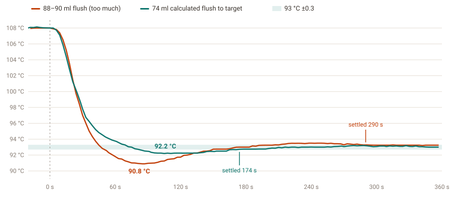

# Boiler temperature control on this fork

What this fork changes in GaggiMate's boiler control, why, and what the bench showed. Measured on a Rancilio Silvia
230 V (1100 W) with a GaggiMate Pro, 2026-10-28/29. Every number below comes from a logged run; the raw tables are in
[ROADMAP.md](../ROADMAP.md).

## Goal

Hold the brew temperature steadily and get back to it quickly after a flush or steaming, without the overshoot the
stock loop produces, and make the result easy to reproduce on another machine. Safety is not traded for any of it:
anything that can heat the boiler sits behind limits the control code can't bypass.

## What we observed

### The sensor is slow, and slow in two different ways

The Silvia's thermocouple sits on the outside of the boiler. Heater heat takes about **20 s** to show on it; cold flush
water shows sooner, with the dip half way down after about **12 s**. A plain PID acting on that reading is always
answering a question from 20 s ago.

### The stock loop overshoots after every flush

After a 5 s flush from 93 °C the original loop overshot by **+2.9 °C on average** (three runs: +2.23, +3.75,
+2.75 °C) and took over **5 minutes** to settle within ±0.3 °C. Three things in the PID made it worse:

- The derivative was taken on the _error_, so every setpoint change (brew ↔ steam, an offset edit) and the first
  sample after a reset kicked the output to full power for a second.
- The derivative term saw the thermocouple's 0.25 °C steps as large jumps, so it spent most of its time clipped at 0 %
  or 100 %.
- During and after a flush the integral wound up on a dip the sensor was still showing after the boiler had
  recovered, then pushed the overshoot.

### Most of the overshoot is heat already on its way

Fitting a model to the logs (`scripts/fit_plant.py`) showed where the heat goes: the element warms the water with a
~21 s time constant, so heat keeps arriving after the heater turns off, and the **group head** (a large brass mass)
slowly trades heat with the water over about 2.4 minutes. After a flush the cooled group head keeps pulling the water
down for minutes.

### A flush takes more heat than the pump reading suggests

Weighing flushes in a jug and the drip tray separately showed the pump reading matches what reaches the cup (89.1 g
against 88.2 ml over five 10 s flushes), but **every flush also dumps 5 g (4.8–5.7 g) into the drip tray** when the
3-way valve releases. That water has left the boiler too. Together with the group head, flush water cools the boiler
about 20 % more per ml than a simple calculation predicts.

### After steaming, the boiler is far too hot to brew

Coming back from steam, the boiler peaks at 106–110 °C against a 93 °C brew target, and a plain wait takes many
minutes to come down. A flush brings it down sooner, but the amount matters. Too much water undershoots: the
boiler drops to about 90.8 °C, the PID then climbs back past the target, and it takes about 5 minutes to settle. A
calculated amount lands near the brew temperature and settles in under 3 minutes:

### The tank warms up

The tank sits beside the boiler: about 25 °C fresh, about 40 °C after a few hours on (and 15–45 °C across a year).
Every flush calculation depends on it.

### Some failure cases the stock checks don't cover

- A thermocouple that comes loose from the boiler reads room temperature, so the PID heats flat out; only the
  machine's own thermal fuse would stop it.
- One autotune run coasted to **131 °C** after reaching its 125 °C limit.
- Once, a brew stopped within a second left the controller reporting 5 ml/s of flow for over a minute with no water
  moving; the compensation counted cold water that wasn't there and heated the boiler from 93 to 98 °C.

## How the code addresses it

| Problem                                                | Change                                                                                                                                                                                                                                                                                                             | Where                                                             | Result on the bench                                                                                                                                                                                   |
| ------------------------------------------------------ | ------------------------------------------------------------------------------------------------------------------------------------------------------------------------------------------------------------------------------------------------------------------------------------------------------------------ | ----------------------------------------------------------------- | ----------------------------------------------------------------------------------------------------------------------------------------------------------------------------------------------------- |
| Derivative kick on setpoint changes                    | Derivative on the measurement, not the error                                                                                                                                                                                                                                                                       | `lib/NayrodPID/src/SimplePID`                                     | No more full-power kicks on brew ↔ steam                                                                                                                                                             |
| D term chattering on sensor steps                      | Optional low-pass filter on the D term (2 s)                                                                                                                                                                                                                                                                       | `SimplePID`, setting _Derivative filter_                          | Idle heater chatter cut about 3× (simulator)                                                                                                                                                          |
| Integral winding up during flushes                     | Integral only within ±1.5 °C, paused while water flows and for the dead time after                                                                                                                                                                                                                                 | `SimplePID`, `Heater`, setting _Integral zone_                    | Part of the combined result below                                                                                                                                                                     |
| Acting on a reading ~20 s old                          | **Heat-balance predictor** (Smith-predictor style): counts heater energy and flush water still on their way to the sensor and adds that to the reading the PID sees                                                                                                                                                | `lib/GaggiMateController/src/peripherals/HeatBalancePredictor.*`  | With one shared 20 s delay: +1.68 °C overshoot, 174 s to settle                                                                                                                                       |
| Flush water and heater heat arrive at different speeds | Separate **water dead time** (12 s on the Silvia)                                                                                                                                                                                                                                                                  | predictor, setting _Water dead time_                              | **+0.63 °C overshoot, 126 s to settle** (from +2.9 °C, 318 s)                                                                                                                                         |
| Standing loss differs between brew and steam           | Loss learned in watts per °C above the room, saved and restored across restarts                                                                                                                                                                                                                                    | predictor, display saves `modelLossW`                             | No sag on start, holds at steam temperature too                                                                                                                                                       |
| Valve dump not counted                                 | ~5 ml counted as boiler water each time the flow stops                                                                                                                                                                                                                                                             | predictor, flush to target, setting _Valve dump per flush_        | Flush to target lands without undershoot (run 7)                                                                                                                                                      |
| Boiler far too hot after steaming                      | **Flush to target**: works out the tank water needed to bring the boiler down to the brew temperature (surplus × heat capacity, per ml at the boiler-minus-tank temperature, less the standing loss during the flush and a heater hold), then flushes exactly that; heater held off for 30 s after                 | `src/display/core/FlushToTarget.h`, `Controller::flushToTarget()` | From ~106 °C: lowest 91.8–92.2 °C, settled within ±0.3 °C 161–174 s after the flush (bigger flushes: 90.8 °C and 287–317 s); with the dump counted, run 7 settled at 87.7–88.0 °C for an 88 °C target |
| Flush to target needs a correction for the group head  | Empirical _Flush to target factor_ (0.91 on the Silvia)                                                                                                                                                                                                                                                            | setting, tuned by the routine below                               |                                                                                                                                                                                                       |
| Using it day to day                                    | The flush button flushes to target when the boiler is 2 °C or more over target (toggle _Flush to brew target when hot_)                                                                                                                                                                                            | `Controller::onFlush()`                                           |                                                                                                                                                                                                       |
| Tank temperature drifting                              | **Tank estimate**: warms from a seasonal fill temperature while on, cools in standby, resets on a refill (button, or the Alba water level back to full), and a check after each plain flush catches a refill it missed                                                                                             | `TankTemperature.h`, `FlushTankCheck.h`                           | Flush-implied tank 31.0, 39.5, 32.5 °C against 32 °C measured                                                                                                                                         |
| Loose thermocouple                                     | **Heater safety layer**: the one place the heater pin is driven asks it first; it latches the heater off for near full power with no water flowing and no 2 °C rise in 60 s (180 s at steam temperatures), implausible jumps, 10 minutes at full power, over 170 °C or a failing sensor, each with its own message | `HeaterSafety.h`, `Heater::writeOutput()`                         | Replayed over all 52 bench logs: never trips                                                                                                                                                          |
| Autotune coasting past its limit                       | Stops when the reading plus rate × measured delay would pass 125 °C, and ends like a timeout (gains kept)                                                                                                                                                                                                          | `Autotune::predictedCoast()`, `Heater::loopAutotune()`            |                                                                                                                                                                                                       |
| Stuck flow reading                                     | Display re-sends "pump off" when flow is reported with nothing running for 3 s                                                                                                                                                                                                                                     | `StrayFlowGuard.h`                                                | Didn't reproduce in four tries; the guard covers it                                                                                                                                                   |

### Setting it up on a machine

All of the above is off or neutral until configured, so a machine that isn't set up behaves like upstream.

- **Machine Boiler Profile** (Settings → Machine) holds the machine-specific values. A **machine profile** picker
  applies a built-in profile (Rancilio Silvia 230 V with everything measured here; starting points for the Gaggia
  Classic family and two DeLonghis) or imports one from JSON; Export JSON saves yours.
- **Tune this machine** (Settings → Calibration) measures the values for a new machine: autotune from cold gives the
  heat-up rate and dead time; a logged and weighed 5 s flush gives the water dead time, the valve dump and a pump
  check; a flush to target after steam sets the correction factor.

## What was tried and dropped

| Idea                                                     | What happened                                                 | Why it went                                                                                                                                      |
| -------------------------------------------------------- | ------------------------------------------------------------- | ------------------------------------------------------------------------------------------------------------------------------------------------ |
| Full-power reheat after a flush                          | Slower back to target (124–129 s against 62–100 s)            | Heat takes ~2 min to reach the sensor; delivering it fast overshoots the wait                                                                    |
| Boost then flush (heat 5 °C over, flush the surplus off) | 366–375 s to settle against 74–84 s                           | Heating up takes as long as a plain recovery, then the flush starts another                                                                      |
| Thermal model controlling the water estimate             | No difference on the sensor (+0.69 vs +0.66 °C, 120 vs 116 s) | Any gain is in the water itself, which needs a probe in the boiler to see                                                                        |
| Heater switching on mains half-cycles                    | Not built                                                     | ~0.02 °C of ripple at holding power, which the sensor can't see                                                                                  |
| Keeping shot temperature up                              | Simulated and measured                                        | A shot's 5 s fill draws ~2 kW, twice the element's 1100 W: in-shot heating lifts the water only ~0.6 °C. Set the profile a little hotter instead |

## Simulator

`test/test_heat_balance_predictor` holds a three-node boiler model (element, water, group head, sensor delay and lag)
fitted to the Silvia's logs. On flushes left out of the fit it tracks the sensor to 0.45 °C rms (the original model:
1.09 °C). The tests check every change to the controller against it, including the bench configurations, a replayed
shot and model errors of ±25 %. Bench runs remain the final word on timing.

## Still open

See [ROADMAP.md](../ROADMAP.md): tank estimate calibration, the first milk steaming under the safety layer, the
Silvia's steam switch wiring, and combining with upstream's setup wizard and its machine presets when that is merged.
